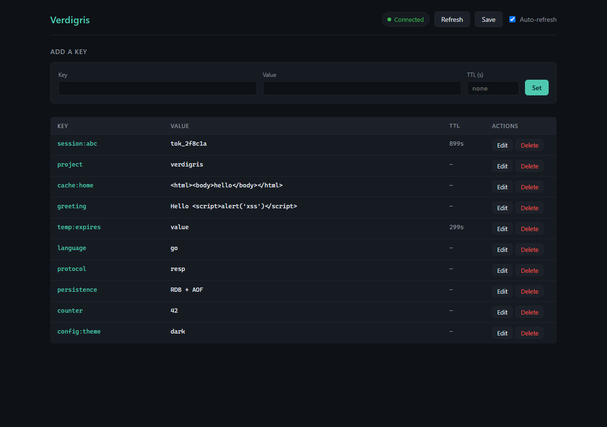

# Verdigris

A Redis-compatible key-value store, written from scratch in Go.



Verdigris speaks RESP over TCP well enough that `redis-cli` and any other Redis
client work against it unchanged, and it keeps that keyspace across a restart
with a point-in-time snapshot, an append-only log, or both. It is built from the
standard library alone — its own protocol codec, its own store, its own file
formats — so the whole engine is readable in an afternoon. The screenshot above
is the admin UI (`cmd/verdigris-ui`) talking to the server as an ordinary RESP
client, the same way `redis-cli` does.

## Quick start

```bash
go run ./cmd/verdigris        # the server, listening on :6379
go run ./cmd/verdigris-ui     # the admin UI, on :8080
```

Then open <http://127.0.0.1:8080> — or skip the UI and use `redis-cli`.

## A real session

Protocol compatibility is the whole claim, so here it is rather than a
description of it. This is a `redis-cli` session against Verdigris, pasted
verbatim from the run that produced the screenshot above:

```console
$ redis-cli -p 6379 PING
PONG
$ redis-cli -p 6379 SET user:1 alice
OK
$ redis-cli -p 6379 GET user:1
alice
$ redis-cli -p 6379 EXISTS user:1
1
$ redis-cli -p 6379 SET session:abc "token-value" EX 300
OK
$ redis-cli -p 6379 TTL session:abc
300
$ redis-cli -p 6379 KEYS *
user:1
session:abc
$ redis-cli -p 6379 DEL user:1
1
$ redis-cli -p 6379 EXISTS user:1
0
$ redis-cli -p 6379 SAVE
OK
```

Nothing above is Verdigris-specific: no new commands, no changed replies, no
extra flags. A client that works against Redis works here.

## Status

Milestones 1–9 complete. The server is a working string store with key
expiration and two persistence mechanisms: `SET`, `GET`, `DEL`, `EXISTS`,
`EXPIRE`, `TTL`, `PERSIST`, `KEYS` and `SAVE` operate on a keyspace shared by
every connection, with `SET ... EX/PX` for time-limited writes. Expired keys
are removed both on access and by a background sweeper, and every TTL test runs
on an injected clock rather than sleeping.

Persistence is an append-only log, a point-in-time snapshot, or both. With
`-aof-path` every write command is appended to a RESP-encoded log and replayed
on startup, so a hard kill loses at most the last un-fsynced second rather
than everything since the last save. With `-rdb-path` the keyspace is written
on graceful shutdown and on `SAVE`, and loaded on startup. Given both, the log
is the startup source of truth and `SAVE` still writes snapshots on demand.

## Why

Verdigris exists to answer a question that using a framework never asks:
what is actually happening underneath? A data server is a socket, a byte
buffer, a parser, a map with expiry rules, and a story about what survives
a crash — and building each of those by hand is the only way to stop taking
them for granted. This project is deliberately not a wrapper around Redis,
not an exercise in wiring a web framework together, and not a portfolio
toy: it is an attempt to understand the engine by building the engine.

## Non-goals

- Not a drop-in replacement for Redis
- Not pursuing 100% command coverage
- Not chasing raw benchmark parity with Redis
- Not using third-party frameworks for the server, protocol, or store

## Roadmap

See [docs/ROADMAP.md](docs/ROADMAP.md).

## Building

```bash
go build ./...
go run ./cmd/verdigris
```

## Running

```bash
go run ./cmd/verdigris              # listens on :6379
go run ./cmd/verdigris -port 7000
go run ./cmd/verdigris -rdb-path ./dump.rdb   # snapshot on shutdown and SAVE
go run ./cmd/verdigris -aof-path ./appendonly.aof -aof-fsync everysec
go run ./cmd/verdigris -aof-path ./appendonly.aof -rdb-path ./dump.rdb
```

Without either path the server keeps everything in memory and writes nothing —
no file is created, and a restart starts empty.

With `-rdb-path` the keyspace is saved on graceful shutdown (Ctrl-C) and on the
`SAVE` command, and loaded at startup. A hard kill loses everything since the
last save.

With `-aof-path` every write command (`SET`, `DEL`, `EXPIRE`, `PERSIST`) is
appended to a log of RESP-encoded commands — the same bytes a client would
send — and replayed at startup. `-aof-fsync` chooses when that log is flushed:

| Value | Meaning |
|---|---|
| `always` | fsync after every write; the slowest and the most durable |
| `everysec` | fsync once per second from a background goroutine (default) |
| `no` | let the operating system decide; fastest, least durable |

`everysec` is Redis's own default and the right trade for a server: a hard kill
loses at most the last second of writes. A crash can also leave the final
command half-written; the loader cuts the log back to the last complete command
and applies the rest rather than refusing to start.

When both paths are set, the log is the startup source of truth and the
snapshot is not loaded — the two describe the same keyspace by different means,
and applying one over the other would either resurrect deleted keys or discard
logged writes. `SAVE` still writes the snapshot, which remains the way to take
a point-in-time copy.

A corrupt log or snapshot is a fatal startup error rather than a silent
fallback to an empty keyspace — a server that cannot read its data should not
pretend there was none.

The snapshot is written atomically: a temporary file is written, synced, and
renamed over the target, so an interrupted save leaves the previous snapshot
intact rather than a half-written one. The log needs no such dance — it is
append-only, so a partial write can only ever damage its last frame, which is
why recovery is a truncation rather than a refusal.

The server speaks RESP, so the real client is the right way to try it:

```bash
redis-cli PING                       # PONG
redis-cli ECHO "hello verdigris"     # "hello verdigris"
redis-cli SET foo bar                # OK
redis-cli GET foo                    # "bar"
redis-cli EXISTS foo                 # (integer) 1
redis-cli DEL foo                    # (integer) 1
redis-cli GET foo                    # (nil)
redis-cli KEYS *                     # every key, e.g. "session"
redis-cli KEYS user:*                # (error) ERR KEYS: only * is supported
redis-cli SET session abc EX 5       # expires in five seconds
redis-cli TTL session                # (integer) 5, then counts down
redis-cli SAVE                       # OK
redis-cli NOTACOMMAND                # (error) ERR unknown command 'NOTACOMMAND'
```

With `-aof-path`, the writes above are logged as they happen. The log is plain
RESP — the exact bytes a client sends — so it can be read with any RESP-aware
tool. After `SET persistent-key "hello"` the file's whole contents are:

```
*3\r\n$3\r\nSET\r\n$14\r\npersistent-key\r\n$5\r\nhello\r\n
```

which is the length-prefixed encoding of the three arguments. Because it is
RESP, it can also be piped straight back into a server: `redis-cli --pipe <
appendonly.aof` re-applies every logged command.

The keyspace is shared by every connection, so a value set by one client is
visible to the next. Command names are case-insensitive, as they are in Redis.
Any RESP client works, not just `redis-cli`; on Windows without one,
PowerShell's `TcpClient` can send the raw bytes:

```powershell
$c = New-Object System.Net.Sockets.TcpClient('127.0.0.1', 6379)
$s = $c.GetStream()
$msg = [Text.Encoding]::ASCII.GetBytes("*1`r`n`$4`r`nPING`r`n")
$s.Write($msg, 0, $msg.Length)
$buf = New-Object byte[] 64
$n = $s.Read($buf, 0, 64)
[Text.Encoding]::ASCII.GetString($buf, 0, $n)   # prints +PONG
$c.Close()
```

Stop it with Ctrl-C; the server closes the listener, waits for in-flight
connections, drains them, flushes the log, writes the snapshot, and exits 0.
`-port` outside 1–65535, a non-positive `-sweep-interval`, an unrecognized
`-aof-fsync`, or a `-rdb-path`/`-aof-path` whose directory does not exist all
print usage and exit 2. A corrupt log or snapshot exits 1 before the listener
opens.

## Web UI

`cmd/verdigris-ui` is a small web interface for browsing and editing the
keyspace. It is a **separate process** from the server: it speaks RESP to
Verdigris exactly as `redis-cli` does, so it has no private access to the store
and can be stopped or restarted without touching the server. Start the server
first, then the UI:

```bash
go run ./cmd/verdigris                              # the server, on :6379
go run ./cmd/verdigris-ui                           # the UI, on :8080
go run ./cmd/verdigris-ui -verdigris 127.0.0.1:6379 -http 127.0.0.1:8080 -web ./web
```

The UI needs two processes running, which is the price of keeping Verdigris a
pure RESP server. It comes up even when Verdigris is down — `/api/health`
reports `{"verdigris":"down"}` and the client reconnects on the first command
that succeeds, so a UI started first will pick up a server that appears later.


Open <http://127.0.0.1:8080> and you get one page: a connection pill that
tracks `/api/health`, an add/edit form, and the keyspace as a table with an
Edit and a Delete button per row. Refresh re-fetches everything, Save asks
Verdigris to write a snapshot, and auto-refresh polls every five seconds until
you untick it — or until a request fails, which pauses it and shows a banner
rather than retrying at a broken server forever. TTL is shown as it was
observed on the last refresh (`—` for no expiry, `gone` for a key that
disappeared), deliberately without a countdown: the number is a point-in-time
reading, and a locally animated one would be inventing data.

The front-end is three static files — `web/index.html`, `web/styles.css`,
`web/app.js` — with no framework, no build step, and nothing loaded from a CDN.
It is served by the same `http.FileServer` as everything else, so what is in
`web/` is exactly what the browser receives. Every key and value is written
into the document with `textContent`, never `innerHTML`: a client can store
`<script>alert('xss')</script>` under any name, and an admin UI is the one
place an operator is guaranteed to look at it.

The JSON API behind the page:

| Method | Path | Purpose |
|---|---|---|
| GET | `/api/health` | Is Verdigris answering? |
| GET | `/api/keys` | `KEYS *` |
| GET | `/api/dump` | Every key with its value and TTL, in one request |
| GET | `/api/get?key=` | Read one key |
| POST | `/api/set` | `{"key","value","ttl"}` — `ttl` optional |
| DELETE | `/api/del?key=` | Delete one key |
| POST | `/api/expire` | `{"key","ttl"}` |
| GET | `/api/ttl?key=` | Remaining time; `-1` no expiry, `-2` missing |
| POST | `/api/save` | Write a snapshot |

Every response is JSON, errors included: `400` when the request was malformed,
`502` when Verdigris is unreachable or answers with an error frame. Static files
come from `-web` (default `./web`).

## Benchmarks

[`docs/BENCHMARKS.md`](docs/BENCHMARKS.md) holds the full matrix — three
concurrency levels across `ping`, `set`, `get` and `mixed` — and the
explanation for every difference it shows. Verdigris was compared against
Redis 5.0.14.1 using one client, `cmd/vg-bench`, with identical flags on both
sides and the only variable being which server was at the other end of the
socket; Verdigris ran with AOF persistence at `everysec` and Redis with RDB
snapshotting disabled, so neither pays a disk round trip on the hot path.

On this Windows host Verdigris serves roughly 3–4× Redis's throughput above
one concurrent client, because Redis's throughput there is flat at
~11–12k ops/sec from 10 clients to 200 — a fixed per-operation cost in that
build rather than anything about Redis on Linux, which this report does not
measure and does not claim to. Verdigris pays for its result in the ways you
would expect: an RWMutex around the store, a copy of the key and value on
every read and write, and `protocol.Encode`/`Decode` running on every request.

Two caveats before you read the numbers. Windows' system clock advances in
~0.5 ms steps, so per-request `p50` reads 0.000 ms on both servers and the
percentiles cannot resolve sub-millisecond latency at all; the trustworthy
figures are ops/sec and mean latency, which is derived from total elapsed time.
And nothing here was profiled, so the *reason* for Redis's ceiling is inferred
from the shape of its curve, not measured.

## License

MIT
